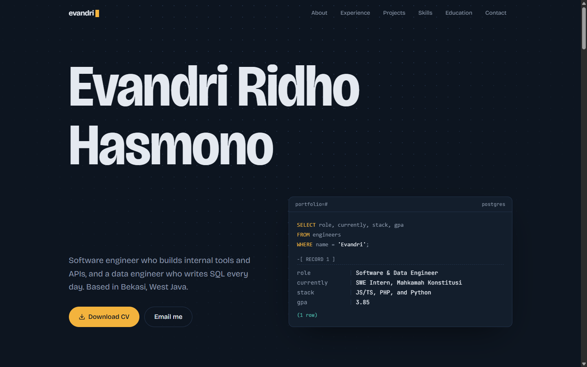

# Evandri Ridho Hasmono — Portfolio

Personal portfolio of **Evandri Ridho Hasmono**, Software & Data Engineer. The site is designed as a SQL console: the hero types a query and "returns" my profile as a Postgres record, and the rest of the page walks through my experience, projects, skills, and credentials.

**Live:** [portopolio-ivory.vercel.app](https://portopolio-ivory.vercel.app)



## Sections

| Section | What it shows |
| --- | --- |
| **Hero** | Name, tagline, CV download, and a SQL console that types a query and returns role, current position, stack, and GPA |
| **About** | Summary from the CV, revealed word by word on scroll, plus quick facts |
| **Experience** | Timeline of internships at Mahkamah Konstitusi RI and PT Pelita Air Service, with a rail that draws as you scroll |
| **Projects** | Personal, academic, and bootcamp projects with model metrics that count up; a pinned horizontal gallery on desktop |
| **Skills** | Languages & frameworks, data & tools, soft skills, and spoken languages |
| **Education & certifications** | Gunadarma University (GPA 3.85 / 4.00), coursework, and certifications |
| **Contact** | Email (with copy-to-clipboard), GitHub, and LinkedIn |

## Tech stack

- [Next.js 16](https://nextjs.org) (App Router, Turbopack), statically prerendered
- [React 19](https://react.dev) and TypeScript (strict)
- [Tailwind CSS v4](https://tailwindcss.com), configured CSS-first in `src/app/globals.css`
- [Framer Motion](https://motion.dev) for scroll-linked and interaction animations
- [Lenis](https://lenis.darkroom.engineering) for smooth scrolling
- [lucide-react](https://lucide.dev) for UI icons, [react-icons](https://react-icons.github.io/react-icons/) for tech logos
- Fonts: Bricolage Grotesque and JetBrains Mono via `next/font`
- Deployed on [Vercel](https://vercel.com)

Animations respect `prefers-reduced-motion`: Framer Motion skips transform animations and Lenis turns smoothing off.

## Getting started

Requires Node.js 24 or newer.

```bash
git clone https://github.com/evandri30/Portopolio.git
cd Portopolio
npm install
npm run dev
```

Open [http://localhost:3000](http://localhost:3000).

| Command | Description |
| --- | --- |
| `npm run dev` | Start the dev server |
| `npm run build` | Production build (must pass before shipping) |
| `npm run start` | Serve the production build |
| `npm run lint` | Run ESLint |

## Project structure

```
src/
  app/
    layout.tsx             fonts, metadata, motion + smooth-scroll providers
    page.tsx               section order
    globals.css            design tokens (colors, fonts, easing)
    icon.svg, favicon.ico, apple-icon.tsx, opengraph-image.tsx
  components/
    sections/              Hero, About, Experience, Projects, Skills, Credentials, Contact
    layout/                Navbar, Footer, MotionProvider, SmoothScroll
    ui/                    Reveal, SectionHeading, ScrollText, CountUp, Marquee, SpotlightPanel
  data/                    all site content (see below)
  lib/motion.ts            shared easing
  types/index.ts           content types
public/cv/cv_evandri.pdf   downloadable CV
```

## Editing content

All copy lives in typed files under `src/data/`. Components only render it, so updating the site rarely means touching a component.

| File | Content |
| --- | --- |
| `profile.ts` | Name, role, tagline, summary, hero query result, quick facts, socials, CV path |
| `experience.ts` | Work experience, education, certifications |
| `projects.ts` | Projects, including optional metrics and live link |
| `skills.ts` | Skill categories (with brand icons), soft skills, spoken languages |
| `navigation.ts` | Navbar links; each `href` must match a section `id` |

`public/cv/cv_evandri.pdf` is the source of truth. When the CV changes, replace the PDF and re-sync the files in `src/data/` against it. Projects list personal, academic, and bootcamp work only; work done for an employer belongs in Experience.

## Deployment

The `main` branch deploys to Vercel automatically. `metadataBase` uses Vercel's `VERCEL_PROJECT_PRODUCTION_URL`, so Open Graph images resolve to the production domain with no extra configuration.

## Contact

- Email: [evandriridhoh@gmail.com](mailto:evandriridhoh@gmail.com)
- LinkedIn: [linkedin.com/in/evandriridho](https://www.linkedin.com/in/evandriridho)
- GitHub: [github.com/evandri30](https://github.com/evandri30)
